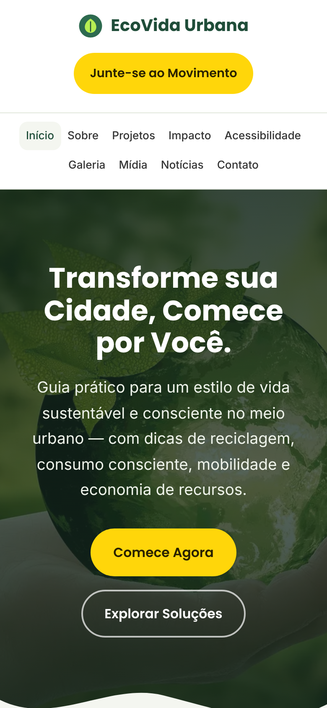
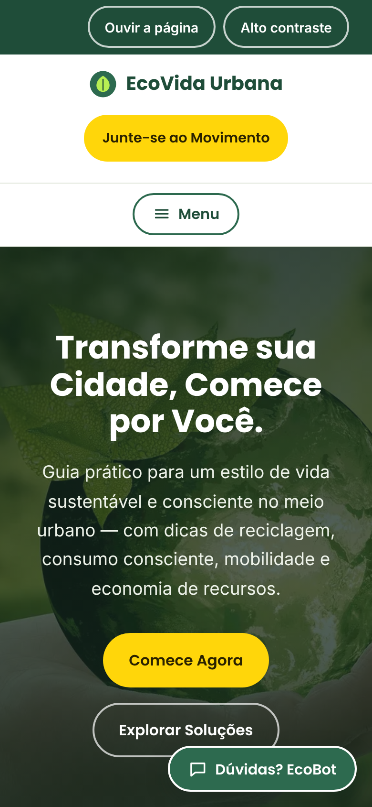
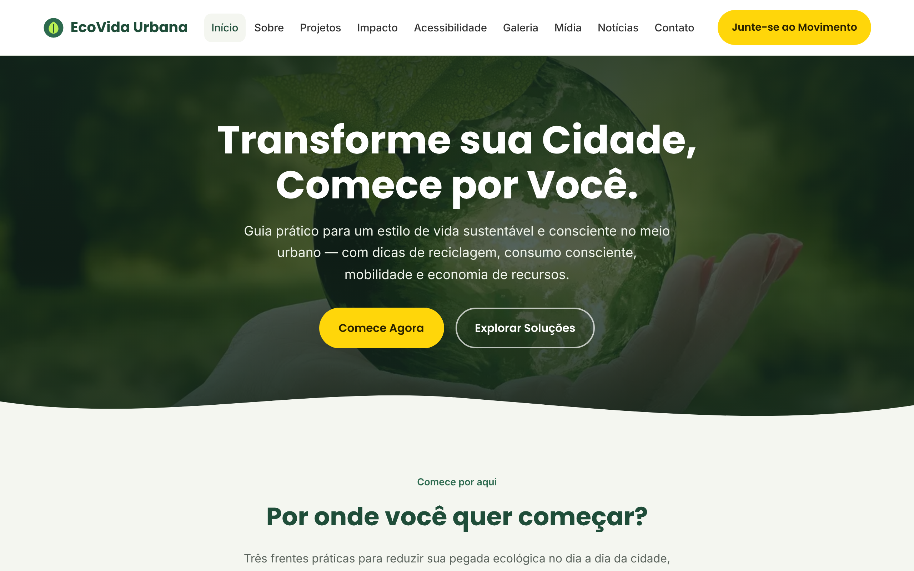
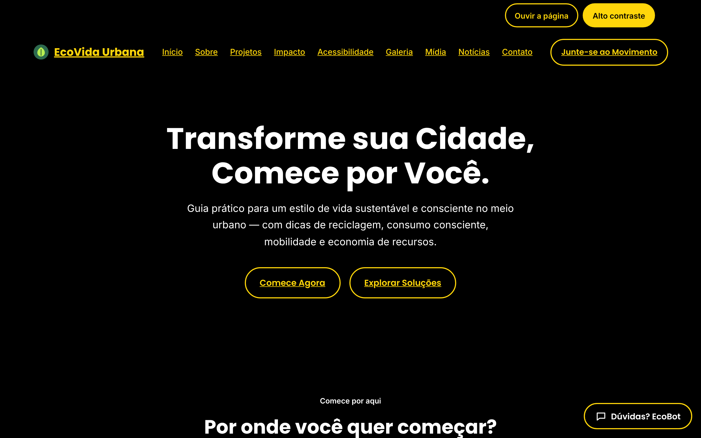
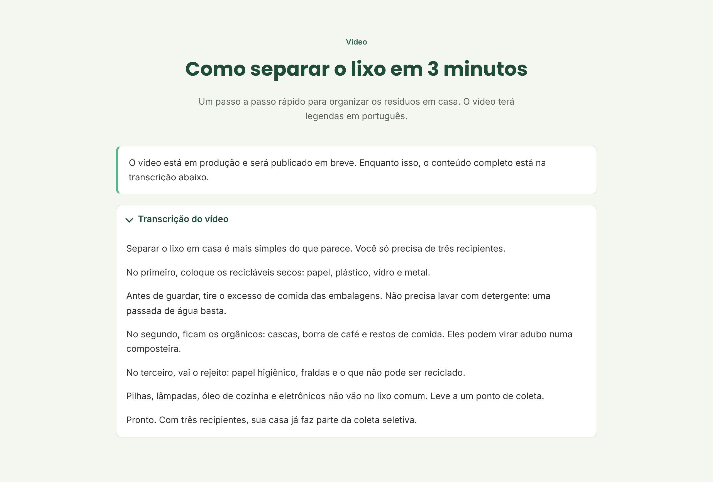
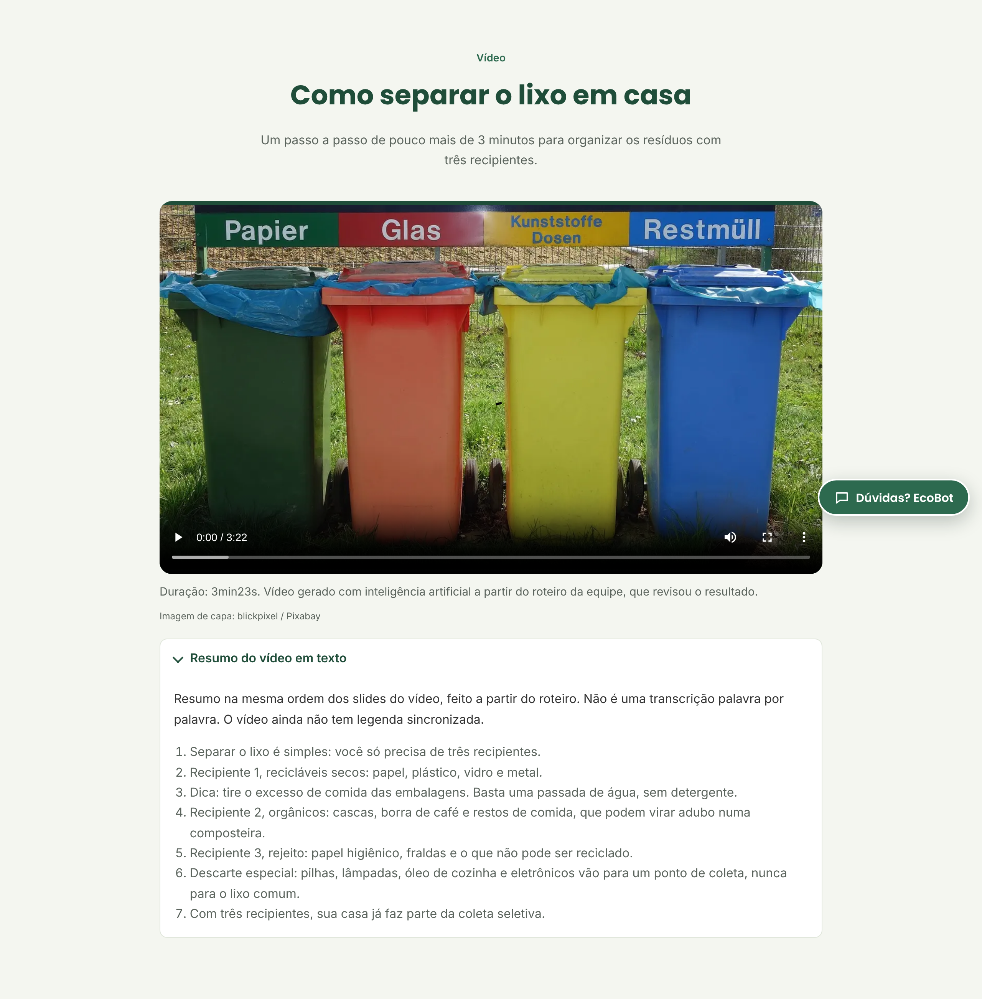
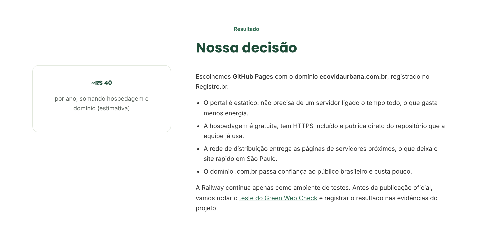
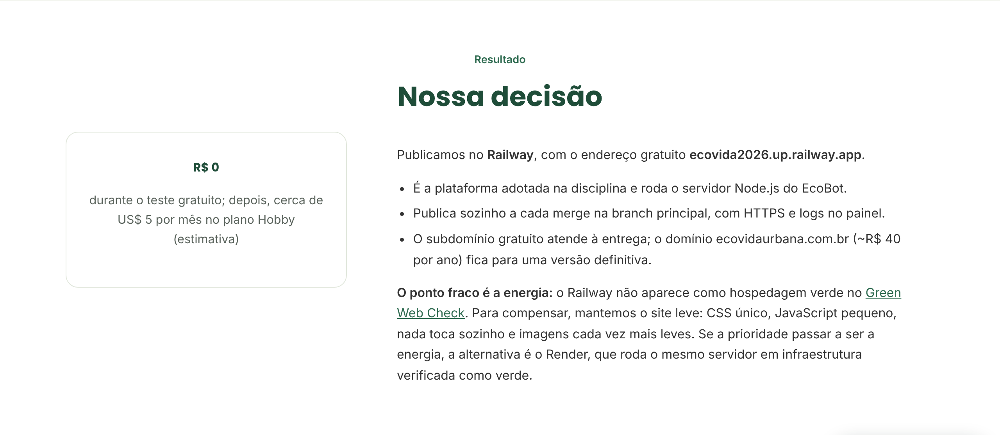
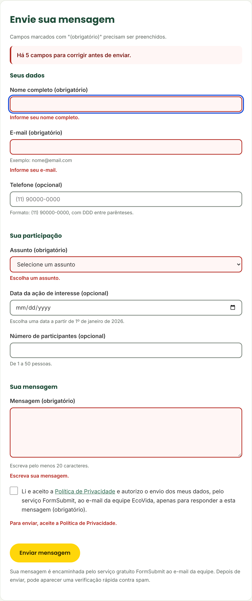

# Melhorias desde o MVP — Portal EcoVida Urbana

**MVP (1ª entrega):** versão de 26/10/2026, commit `fd3c543`: 10 páginas em HTML5 + CSS3, sem JavaScript, com a pasta do site na raiz do repositório.
**Versão final (2ª entrega):** https://ecovida2026.up.railway.app/, com o histórico completo no GitHub.

O professor não fez apontamentos formais na 1ª entrega. A equipe comparou o MVP com o roteiro da 2ª entrega e com o próprio escopo, listou o que faltava ou estava inconsistente e abriu uma issue para cada ponto. Cada correção entrou por uma branch própria e um pull request.

## Resumo

| # | Ponto do MVP | Como foi resolvido | PR |
|---|---|---|---|
| 1 | Formulário validado só por HTML5, com a mensagem padrão do navegador | Validação com JavaScript: `preventDefault`, mensagem embaixo de cada campo, borda vermelha, `aria-invalid` e rascunho salvo no `localStorage` | feat/validacao-formulario |
| 2 | No celular, os 9 links do menu ocupavam o topo da tela | Menu recolhível com botão "Menu" (`aria-expanded`, Esc fecha); sem JS, a lista continua visível | #18 |
| 3 | Nenhum recurso de acessibilidade além do HTML | Barra no topo com "Ouvir a página" (leitura por voz) e "Alto contraste" (preferência salva no `localStorage`) | #14 |
| 4 | Página de Mídia sem vídeo ("em produção") e com áudio apontando para um arquivo que não existia | Vídeo de 3min23s e episódio do podcast publicados, cada um com resumo em texto | #21 |
| 5 | Orçamento escolhia o GitHub Pages, mas o site estava publicado no Railway | Decisão revista e justificada com o Railway, citando o ponto fraco (energia) e a alternativa verde | #16 |
| 6 | Fotos carregadas do CDN do Pixabay em 1280 px (6,4 MB no total) | Fotos salvas em `public/img/` em WebP, até 200 KB cada; o total caiu para 2,1 MB (−67%) | #17 |
| 7 | Site em pastas soltas, sem servidor e sem dúvidas rápidas | Site movido para `public/`, servidor Node.js + Express e assistente EcoBot (FAQ por palavras-chave) | #12, #13 |
| 8 | Home dizia que o JavaScript e o mapa viriam "numa próxima entrega" | Textos atualizados, apontando para o mapa da página de Mídia | fix/textos-home |
| 9 | IA usada sem contexto organizado | Plano de contexto (`docs/plano-contexto.md`) e 8 regras em `.cursor/rules/` | #1, #2, #20 |
| 10 | Commits enviados por upload, sem padrão de mensagem nem revisão | Uma branch por tarefa, commits com prefixo (`feat:`, `fix:`, `docs:`), modelos de issue e de PR | #3 |

## Antes e depois

### 2. Menu no celular

| Antes (MVP) | Depois |
|---|---|
|  |  |

No MVP, os 9 links e o botão empurravam o conteúdo para baixo em telas de 390 px. Agora o menu fica atrás de um botão e abre em coluna.

### 3. Barra de acessibilidade

| Antes (MVP) | Depois (alto contraste ativo) |
|---|---|
|  |  |

O alto contraste usa preto, branco e amarelo (acima de 13:1) e continua ligado ao trocar de página.

### 4. Vídeo na página de Mídia

| Antes (MVP) | Depois |
|---|---|
|  |  |

### 5. Decisão de hospedagem

| Antes (MVP) | Depois |
|---|---|
|  |  |

### 1. Formulário de contato (depois)

Ao enviar vazio, aparece "Há 5 campos para corrigir antes de enviar", o foco vai para o primeiro erro e cada campo mostra o que falta.

## Próximos passos

- Aplicativo móvel do EcoVida Urbana, para consultar pontos de coleta e dicas direto no celular.
- Melhoria no site: o EcoBot passar a responder com IA, com a chave guardada só no servidor.

> Observação: nos prints do MVP, as fotos aparecem pelas cópias locais em WebP, porque o CDN do Pixabay usado na época não abre no ambiente em que os prints foram gerados. As fotos são as mesmas.
